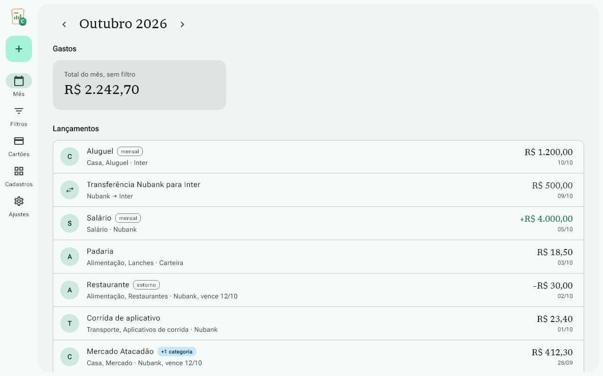
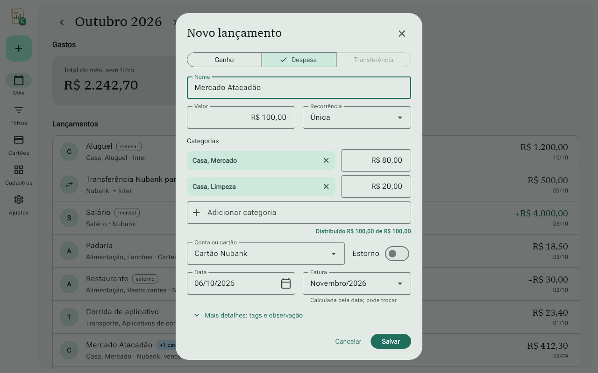
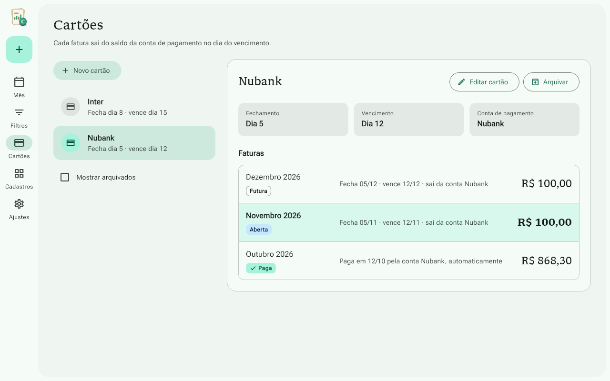

# Centavinhos

[Português (Brasil)](README.pt-BR.md)

**Personal finance, made simple.**

A personal finance app for Windows, built with Flutter. Log income and expenses
in seconds using only the keyboard, track credit cards by statement, and see how
much money you have today and how much will be left at the end of the month.
Everything stays on your computer: no internet, no login.

The app interface is in Brazilian Portuguese.

## Who it's for

People who want to keep their month under control (cash, Pix and credit cards)
without the complexity of full-featured finance apps.

## Screenshots

Month view, with the entries and the total spending:



Quick entry, with one purchase split across two categories:



Credit card statements, with a refund turned into credit for the next one:



These are the app's own screenshots, generated by the tests with sample data.

## What it does

Working now:

- Accounts (wallet and banks) with an opening balance, credit cards, categories
  and tags
- Quick entry for income and expenses, all with Tab and Enter, with an
  ATM-style amount field and several categories per entry
- Credit cards with closing and due dates: each purchase counts in the month of
  its statement, with installments and refunds
- Month view with the list of entries and total spending

Coming next:

- Monthly recurring entries (salary, subscriptions, rent)
- Today's balance, projected balance and a warning before an account goes
  negative
- Transfers between accounts
- Saved filters and PDF reports
- Four theme colors, light or dark mode, backup and restore

Every amount is stored in cents, as an integer, to avoid rounding errors.

## Status

In development. Version 1 is built in 11 stages, and the first 5 are done: see
the [roadmap](ROADMAP.md). What was done in each stage is in
[PROGRESSO.md](PROGRESSO.md), and what version 1 will include is in the
[scope document](docs/escopo-v1-centavinhos.md). Both are in Portuguese.

## Built with

- Flutter for Windows and Dart
- Material 3 with the `material_ui` package
- SQLite with Drift
- Riverpod
- Libron and Roboto Flex fonts
- Planned for the PDF reports (stage 9): the `pdf` and `printing` packages

## Running

You need:

- Windows 10 or 11
- Flutter (stable channel) and Git
- Visual Studio 2022 with the "Desktop development with C++" workload
- Developer Mode turned on in Windows (Settings, System, For developers), so
  Flutter can build the Windows plugins

Then, in the project folder:

```powershell
flutter pub get
flutter run -d windows
```

The Drift database code (`lib/data/database.g.dart`) is already in the
repository. Generate it again only after changing `lib/data/tabelas.drift` or
`lib/data/database.dart`:

```powershell
dart run build_runner build
```

Unit, widget and golden tests:

```powershell
flutter test
```

Integration tests, one file at a time:

```powershell
flutter test integration_test/cadastros_test.dart -d windows
```

## License

The Centavinhos source code is licensed under the
[Apache License 2.0](LICENSE).

The name "Centavinhos" and the logo are not covered by the license. The Libron
and Roboto Flex fonts are under the SIL Open Font License 1.1. See the
[NOTICE](NOTICE) file for details.
