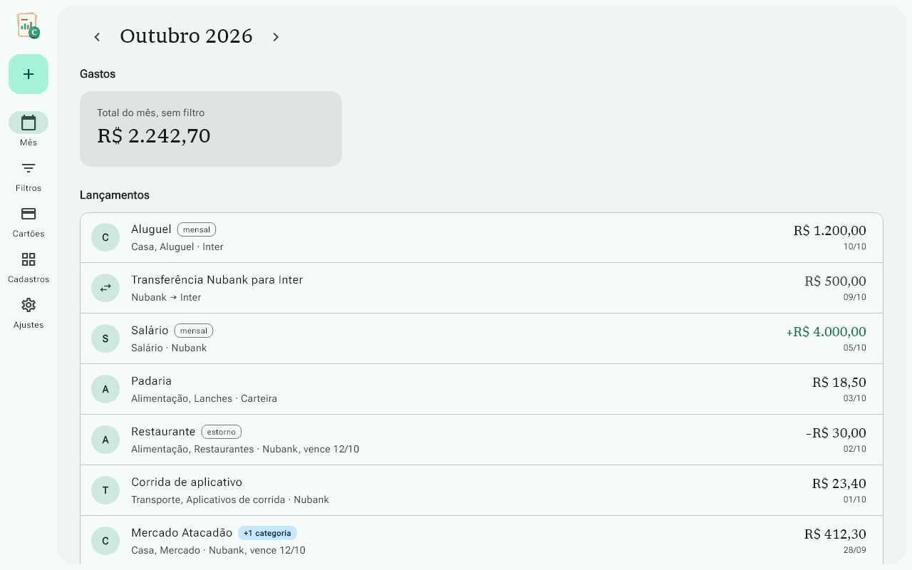
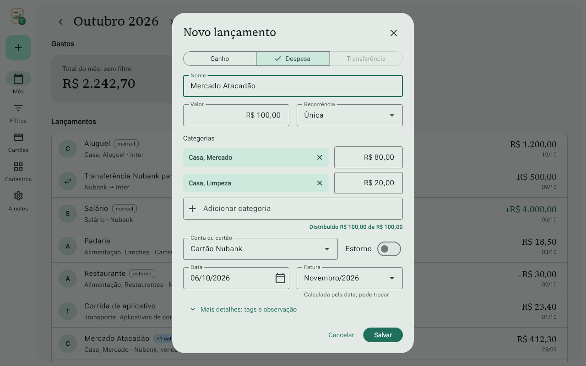
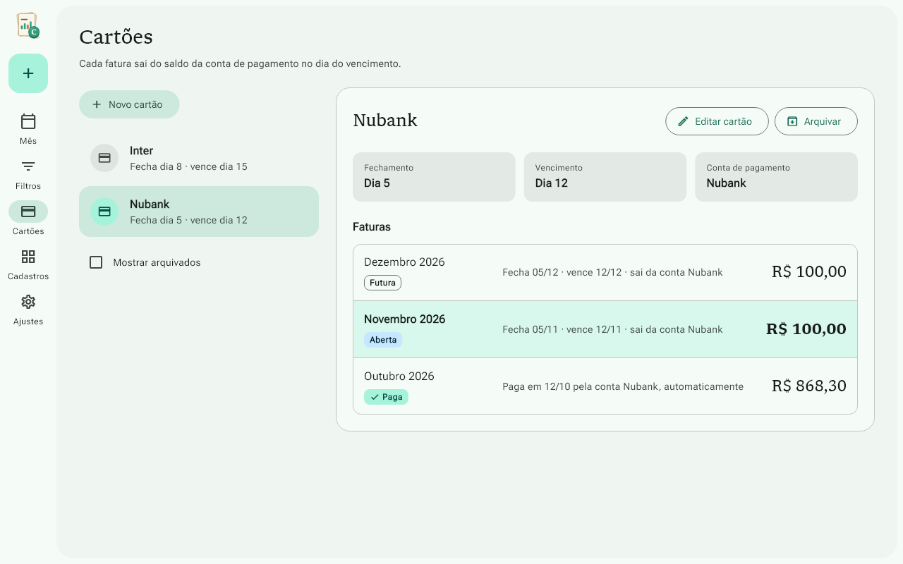

# Centavinhos

[English](README.md)

**Finanças descomplicadas.**

App de finanças pessoais para Windows, feito em Flutter. Você lança ganhos e
despesas em poucos segundos, só com o teclado, acompanha os cartões pela fatura
e vê quanto tem hoje e quanto vai sobrar no fim do mês. Tudo fica salvo no seu
computador, sem internet e sem login.

## Para quem é

Para quem quer controlar o mês (dinheiro, Pix e cartões) sem a complexidade dos
apps completos de finanças.

## Telas

Tela do mês, com os lançamentos e o total de gastos:



Lançamento rápido, com uma compra dividida em duas categorias:



Faturas do cartão, com um estorno que vira crédito na fatura seguinte:



São capturas do próprio app, geradas pelos testes com dados de exemplo.

## O que ele faz

Já funciona:

- Contas (carteira e bancos) com saldo inicial, cartões, categorias e tags
- Lançamento rápido de ganho e despesa, todo com Tab e Enter, com valor no
  estilo caixa eletrônico e várias categorias por lançamento
- Cartões com fechamento e vencimento: cada compra conta no mês da fatura, com
  compras parceladas e estornos
- Tela do mês com a lista de lançamentos e o total de gastos

A caminho:

- Lançamentos mensais (salário, assinaturas, aluguel)
- Saldo de hoje, saldo previsto e aviso antes de uma conta ficar negativa
- Transferências entre contas
- Filtros salvos e relatório em PDF
- Quatro cores de tema, modo claro ou escuro, backup e restauração

Todo valor é guardado em centavos, como número inteiro, para não haver erro de
arredondamento.

## Andamento

Em desenvolvimento. A versão 1 é construída em 11 etapas, e as 5 primeiras estão
prontas: veja o [roadmap](ROADMAP.pt-BR.md). O que foi feito em cada uma está no
[PROGRESSO.md](PROGRESSO.md). O que a versão 1 vai ter está no
[escopo](docs/escopo-v1-centavinhos.md).

## Feito com

- Flutter para Windows e Dart
- Material 3 pelo pacote `material_ui`
- SQLite com Drift
- Riverpod
- Fontes Libron e Roboto Flex
- Previstos para o relatório em PDF (etapa 9): os pacotes `pdf` e `printing`

## Como rodar

Você precisa de:

- Windows 10 ou 11
- Flutter (canal estável) e Git
- Visual Studio 2022 com a carga de trabalho "Desenvolvimento para desktop com
  C++"
- Modo de Desenvolvedor ligado no Windows (Configurações, Sistema, Para
  desenvolvedores), para o Flutter montar os plugins do Windows

Depois, na pasta do projeto:

```powershell
flutter pub get
flutter run -d windows
```

O código do banco gerado pelo Drift (`lib/data/database.g.dart`) já está no
repositório. Gere de novo só depois de mudar `lib/data/tabelas.drift` ou
`lib/data/database.dart`:

```powershell
dart run build_runner build
```

Testes rápidos e capturas de tela:

```powershell
flutter test
```

Testes de integração, um arquivo por vez:

```powershell
flutter test integration_test/cadastros_test.dart -d windows
```

## Licença

O código do Centavinhos é licenciado sob a [Apache License 2.0](LICENSE).

O nome "Centavinhos" e o logo não fazem parte da licença. As fontes Libron e
Roboto Flex seguem a SIL Open Font License 1.1. Detalhes no arquivo
[NOTICE](NOTICE).
