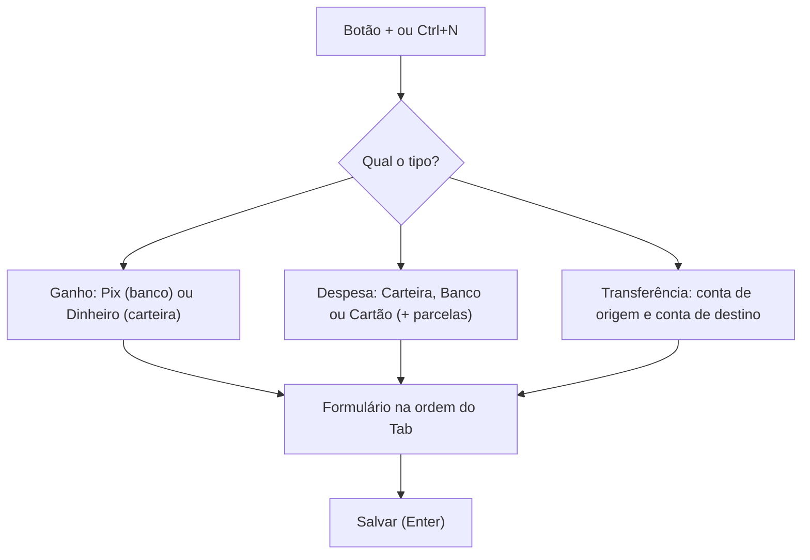

# Escopo v1: Centavinhos

12/10/2026 · João Victor das Neves Sousa Almeida

## Visão geral

**Centavinhos · Finanças descomplicadas.** O nome brinca com uma regra do próprio app, que guarda todo valor em centavos, e soa natural no dia a dia: "vou lançar isso no Centavinhos".

A versão 1 do Centavinhos é um app desktop para Windows que faz bem cinco coisas: lançar ganhos e despesas em poucos segundos, controlar os gastos dos cartões por fatura, mostrar o saldo de hoje e o saldo previsto, salvar filtros e gerar relatórios em PDF a partir deles. Tudo fica salvo localmente, sem internet e sem login.

Princípios que guiam cada decisão:

- **Poucos campos.** O formulário só mostra o que é usado no dia a dia. Campos extras ficam recolhidos.
- **Teclado primeiro.** O lançamento é feito todo com Tab e Enter, sem precisar do mouse.
- **Saldo sem burocracia.** Carteira e bancos ficam em Contas, cada uma com saldo inicial. O app calcula o saldo sozinho, sem marcar nada como "pago".
- **O cartão manda no mês.** Gastos no cartão contam no mês da fatura, não no dia da compra. A fatura sai do saldo no vencimento, sem virar despesa de novo.
- **Dinheiro em centavos.** Valores são guardados como número inteiro (R$ 12,50 vira 1250) para evitar erros de arredondamento.

## Escopo da versão 1

A versão 1 cobre o que você usa toda semana e todo mês no Minhas Finanças. Tudo que você nunca usa fica de fora.

| Entra na versão 1 | Fica fora da versão 1 |
| --- | --- |
| Lançamento rápido de ganho, despesa e transferência | Conciliação com extrato bancário |
| Contas (carteira e bancos) com saldo inicial | Pagamento parcial de fatura |
| Saldo de hoje e saldo previsto, por conta e total | Investimentos |
| Aviso quando uma conta vai ficar negativa | Notificações do Windows fora do app |
| Transferência entre contas | Orçamentos e limites por categoria |
| Cartões com fechamento, vencimento e fatura por mês | Objetivos e metas |
| Pagamento automático da fatura no saldo, com ajuste manual | Anexos e comprovantes |
| Compras parceladas no cartão | Sincronização na nuvem e login |
| Lançamentos recorrentes (mensais) | Versão mobile, macOS e Linux |
| Categorias com subcategorias e valor próprio para cada uma | Importação de extrato bancário |
| Tags e observação (campos opcionais) | Gráficos avançados |
| Estorno no cartão, abatendo da fatura | |
| Boas-vindas na primeira abertura, com categorias padrão | |
| Filtros salvos com total do mês e comparação | |
| Relatório em PDF gerado a partir de um filtro | |
| Tema com quatro opções de cor e modo claro ou escuro | |
| Backup e restauração do arquivo do banco | |

## Lançamento rápido

Um lançamento leva três passos: tocar no botão +, escolher Ganho, Despesa ou Transferência e preencher os campos na ordem do Tab.



Ganho e despesa usam o mesmo formulário e só mudam as opções de origem. Transferência tem um formulário menor, sem categoria.

**Campos principais**, na ordem do Tab:

| Ordem | Campo | Obrigatório | Observação |
| --- | --- | --- | --- |
| 1 | Nome (descrição) | Sim | Com sugestões a partir de nomes já usados. Escolher um nome conhecido preenche o resto (veja abaixo) |
| 2 | Valor | Sim | Estilo caixa eletrônico (veja abaixo), salvo em centavos |
| 3 | Recorrência | Não | Única (padrão), mensal ou parcelada (só no cartão) |
| 4 | Categoria | Sim | Uma ou mais. Com mais de uma, você digita o valor de cada |
| 5 | Conta ou cartão | Sim | Carteira, banco ou cartão, conforme o tipo |
| 6 | Data de lançamento | Sim | Hoje como padrão. Aceita dd/mm (completa o ano atual) ou dd/mm/aaaa, e tem calendário |
| 7 | Fatura | Só no cartão | Já calculada pela data e editável (ex.: novembro/2026) |

**Campos opcionais**, recolhidos em "Mais detalhes": tags e observação. As hashtags do Minhas Finanças viram tags.

**Valor estilo caixa eletrônico:** o campo já mostra "R$ 0,00" e cada número digitado entra pela direita. Digitando 1, 2, 5 e 0, ele mostra R$ 0,01, R$ 0,12, R$ 1,25 e R$ 12,50. Backspace apaga o último número, e vírgula ou ponto são ignorados. Colar um texto como "12,50" também funciona. Os campos de valor da multicategoria funcionam do mesmo jeito.

**Nome conhecido preenche o resto:** ao escolher uma sugestão de nome já usado, o app repete da última vez a categoria (ou as categorias), a conta ou cartão, a recorrência e as tags. O valor não é copiado. Com mais de uma categoria, os campos de valor de cada uma ficam vazios para você distribuir. Tudo pode ser trocado antes de salvar.

**Estorno no cartão:** numa despesa no cartão, a chave "Estorno" (ao lado do campo Conta ou cartão) marca uma compra cancelada ou devolução. O estorno entra na fatura do mês pela mesma regra de fechamento e abate do total dela, dos totais de gastos, dos filtros e do PDF, sempre com sinal de menos ("−R$ 50,00" e a etiqueta "estorno"). Ele também tem categoria, para abater do gasto daquela categoria.

**Multicategoria no formulário:** a partir da segunda categoria, abre uma lista com um campo de valor para cada uma, todos vazios. Não há limite de categorias por lançamento. Embaixo, um contador mostra "Distribuído R$ 80,00 de R$ 100,00, faltam R$ 20,00". O botão Salvar só libera quando a soma bate com o valor total.

**Multicategoria na tela:** a lista mostra uma etiqueta só ("Mercado +1"). Um clique abre a divisão, com o valor de cada categoria.

**Transferência**, na ordem do Tab: valor, conta de origem, conta de destino, data e observação opcional. O nome é gerado sozinho ("Transferência Nubank para Inter"). Pode ser única ou mensal. Ela muda o saldo das duas contas, aparece na lista do mês com cor neutra e fica fora dos totais de gastos, dos filtros e dos relatórios.

Atalhos de teclado: Ctrl+N abre um novo lançamento, Enter no último campo salva, Esc cancela.

**Editar e excluir:** um clique no lançamento abre o mesmo formulário para editar. Excluir pede confirmação e mostra "Desfazer" por alguns segundos. Em parcelas e recorrências, o app pergunta "só este", "este e os próximos" ou "todos".

## Cartões, parcelas e recorrência

Uma despesa no cartão entra no mês da fatura, calculado pelo dia de fechamento. O mês da fatura é o mês do vencimento.

**Regra da fatura**

1. Compra feita antes do dia de fechamento entra na fatura que fecha naquele mês.
2. Compra feita no dia do fechamento ou depois entra na fatura seguinte.
3. Se o dia de vencimento for menor que o de fechamento (fecha dia 28, vence dia 5), o vencimento cai no mês seguinte ao fechamento.
4. O mês da fatura é calculado ao salvar e guardado no lançamento, para os filtros ficarem rápidos.
5. Dia de fechamento ou vencimento que não existe no mês (31 em abril, 30 em fevereiro) vira o último dia daquele mês.
6. O campo Fatura aparece no formulário já preenchido e pode ser trocado. Trocado à mão, ele não é mais recalculado, nem se o fechamento do cartão mudar. Numa compra parcelada, a troca vale para a primeira parcela e as outras seguem nos meses seguintes.

**Exemplo**, com um cartão que fecha dia 5 e vence dia 12:

| Compra | Data | Fatura | Vencimento |
| --- | --- | --- | --- |
| Mercado | 03/10 | Outubro | 12/10 |
| Farmácia | 06/10 | Novembro | 12/11 |

**Parcelas**

- Uma compra de R$ 300 em 3x no dia 06/10 gera três lançamentos de R$ 100: "Fone (1/3)" em novembro, "Fone (2/3)" em dezembro e "Fone (3/3)" em janeiro.
- Os três ficam ligados por um mesmo grupo de parcelamento, para editar ou excluir todos de uma vez.
- Se a divisão não for exata, os centavos que sobram vão para a primeira parcela.

**Recorrência**

- Na versão 1 só existe recorrência mensal, para ganhos e despesas (salário, assinaturas, aluguel).
- O app cria os lançamentos do mês atual e do próximo, para a visão do próximo mês já mostrar o que vem.
- Ao editar um lançamento recorrente, o app pergunta: "só este" ou "este e os próximos".
- Os lançamentos que faltam são criados ao abrir o app e ao mudar o mês, sempre até o fim do mês seguinte.
- Recorrência no dia 31 cai no último dia dos meses mais curtos.

**Pagamento da fatura**

- Cada cartão tem uma conta de pagamento padrão (ex.: o cartão Nubank é pago pela conta Nubank).
- No dia do vencimento, o total da fatura sai do saldo dessa conta automaticamente. Ele não vira despesa, para o gasto não ser contado duas vezes nos relatórios.
- Se você pagou em outra data ou por outra conta, o botão "Ajustar pagamento" na fatura troca a data e a conta.
- Total da fatura = compras do mês − estornos do mês. Se os estornos passarem das compras, a fatura fica em R$ 0,00 e a sobra vira crédito que abate a fatura seguinte.

## Filtros salvos e visão do mês

Um filtro salvo é um nome mais um conjunto de critérios, aplicado sempre ao mês escolhido. Ele substitui o uso que você faz hoje para ver o gasto mensal dos cartões.

**Critérios de um filtro** (todos opcionais; vazio significa "todos"):

- Tipo: ganho, despesa ou ambos (estornos vão junto com as despesas, subtraindo)
- Cartões
- Contas (carteira e bancos)
- Categorias e subcategorias
- Tags
- Texto no nome (pega todo lançamento cujo nome contém o texto, por exemplo "mercado")

**Como o mês é contado:** despesas no cartão contam pelo mês da fatura; os demais lançamentos contam pela data de lançamento.

**Como a categoria é contada:** num filtro por categoria, entra só a parte do valor daquela categoria. Num filtro sem categoria, o lançamento entra uma vez, com o valor inteiro.

**Tela do mês** (a tela inicial):

- Seletor de mês no topo, com setas para o anterior e o próximo.
- Seletor de filtro ao lado, com a opção "Sem filtro".
- Primeira linha de totais, de gastos: total do mês sem filtro, total do mês com o filtro escolhido e total do próximo mês com o mesmo filtro.
- Segunda linha, de saldo: saldo de hoje e saldo previsto no fim do mês (detalhes na seção seguinte).
- Abaixo, a lista de lançamentos do mês, já filtrada, com botão para gerar o PDF.

O total do próximo mês soma o que já é conhecido: parcelas futuras e lançamentos recorrentes. Ele não é uma previsão de gastos novos.

## Saldo de hoje e saldo previsto

O app mostra dois números: o dinheiro que você tem hoje e quanto vai sobrar no fim do mês depois de tudo que já está previsto, incluindo as faturas dos cartões.

**As duas contas:**

- **Saldo de hoje** = saldos iniciais das contas + ganhos até hoje − despesas em conta até hoje − faturas já vencidas.
- **Saldo previsto** = saldo de hoje + ganhos previstos até o fim do mês − despesas em conta previstas − faturas que vencem até lá.
- **Transferências** não mudam o saldo total: tiram de uma conta e põem na outra.
- **Antes do saldo inicial:** lançamentos em conta e faturas com data anterior à data do saldo inicial da conta não mexem no saldo, porque esse dinheiro já está no saldo inicial. Eles continuam contando nos gastos do mês.
- **Previsto** é qualquer lançamento com data futura, como recorrências e contas lançadas antes. Não existe botão de "pago": quando a data chega, o valor passa para o saldo de hoje.

**Exemplo**, em 12/10, olhando outubro:

| Item | Valor |
| --- | --- |
| Saldo de hoje (12/10) | R$ 3.000,00 |
| Salário previsto (30/10) | + R$ 4.000,00 |
| Aluguel previsto (15/10) | − R$ 1.200,00 |
| Fatura Nubank (vence 20/10) | − R$ 1.500,00 |
| **Saldo previsto em 31/10** | **R$ 4.300,00** |

**Na tela:** dois cartões lado a lado, "Saldo hoje" e "Previsto em 31/10". Um clique no previsto abre essa mesma tabela, e um seletor mostra o saldo por conta (Carteira, Nubank, Inter) ou o total. Ao navegar para outro mês, o previsto passa a ser o do fim daquele mês.

**Aviso de saldo insuficiente**

O app nunca bloqueia um lançamento por falta de saldo: ele registra o que aconteceu, e uma conta pode ficar negativa (cheque especial, atraso). Em vez de bloquear, ele avisa cedo, em três lugares:

1. **Ao salvar:** se o lançamento deixa alguma conta negativa em algum dia até o fim do mês, aparece uma mensagem rápida no rodapé, sem travar nada: "Com este lançamento, Nubank fica em −R$ 200,00 em 20/10".
2. **Na tela do mês:** o cartão do saldo previsto ganha a etiqueta "Atenção", e uma faixa acima da lista diz qual conta, em que dia e por quê: "Nubank fica negativa em 20/10, no vencimento da fatura (−R$ 200,00)".
3. **Ação direta:** a faixa tem o botão "Transferir", que abre uma transferência já preenchida para a conta e o valor que faltam.

Como o cálculo funciona: o app percorre os dias até o fim do mês, conta por conta, somando entradas e saídas previstas. O primeiro dia em que uma conta fica abaixo de zero é o que aparece no aviso. Olhar só o saldo do fim do mês esconderia um buraco no meio dele, como uma fatura que vence antes do salário cair.

## Relatório em PDF

O PDF é gerado a partir de um filtro e de um mês, com cabeçalho de resumo e uma tabela de lançamentos.

**Cabeçalho:** logo com o nome (assets/pdf/logo_horizontal.png), nome do filtro, mês de referência, data e hora em que foi gerado e valor total. A prévia visual do PDF foi feita antes do logo e não o mostra.

**Tabela**, uma linha por lançamento e categoria. Um lançamento com duas categorias vira duas linhas, cada uma com a sua parte do valor:

| Coluna | Conteúdo | Exemplo | Some quando vazia? |
| --- | --- | --- | --- |
| Nome | Descrição, com a parcela atual quando parcelado | Fone (2/3) | Não |
| Cartão + vencimento | Nome do cartão e data de vencimento da fatura | Nubank, 12/11 | Sim |
| Conta | Carteira ou banco | Inter | Sim |
| Categoria + subcategoria | As duas juntas | Casa, Mercado | Não |
| Lançamento | Data de lançamento | 06/10 | Não |
| Valor | Em reais, alinhado à direita; a parte da categoria quando dividido; estorno com sinal de menos | R$ 100,00 | Não |
| Tags | Opcional | trabalho | Sim |

**Rodapé:** "Centavinhos", nome do filtro, mês de referência e número da página ("Centavinhos · Cartões do mês · Outubro 2026 · Página 1 de 2").

**Colunas automáticas:** antes de montar o PDF, o app verifica cada coluna marcada com "Sim". Se ela estiver vazia em todas as linhas do filtro, ela não aparece e as outras ganham o espaço. Exemplo: um filtro só de cartões não mostra a coluna Conta.

Ordem padrão: por data de lançamento, da mais antiga para a mais recente. Opção no momento de gerar: mostrar a observação abaixo do nome.

## Telas

A versão 1 tem sete telas, com um menu lateral simples e o botão + sempre visível. As imagens de referência estão em `docs/telas/` (a de boas-vindas e o estorno ainda não têm prévia).

| Tela | Para que serve | O que tem |
| --- | --- | --- |
| Mês (inicial) | Ver e avaliar o mês | Seletor de mês e de filtro, totais de gastos, saldo de hoje e previsto, lista de lançamentos, botão de PDF |
| Novo lançamento | Lançar ganho, despesa ou transferência | Janela sobre a tela atual, formulário na ordem do Tab |
| Filtros | Criar e editar filtros salvos | Lista de filtros e editor de critérios, com prévia do resultado no mês |
| Cartões | Cartões e faturas | Nome, fechamento, vencimento, conta de pagamento; faturas por mês com "Ajustar pagamento" |
| Cadastros | Contas, categorias e tags | Abas; contas com saldo inicial; listas com adicionar, renomear e arquivar |
| Configurações | Tema e backup | Cor do tema, modo claro ou escuro, exportar e importar o arquivo do banco |
| Boas-vindas | Primeira abertura | Só aparece com o banco vazio: cadastrar as contas com o saldo de hoje (ao menos uma) e, se quiser, os cartões. Depois vai para a tela do mês |

Nenhum cadastro é apagado de vez: contas, cartões e categorias usados em lançamentos são arquivados, para não quebrar relatórios antigos.

**Categorias padrão**, criadas junto com o banco e editáveis em Cadastros:

| Tipo | Categoria | Subcategorias |
| --- | --- | --- |
| Despesa | Casa | Aluguel, Mercado, Limpeza, Contas de casa, Manutenção |
| Despesa | Alimentação | Restaurantes, Delivery, Lanches |
| Despesa | Transporte | Combustível, Transporte público, Aplicativos de corrida |
| Despesa | Saúde | Remédios, Consultas, Plano de saúde |
| Despesa | Assinaturas | Streaming, Aplicativos |
| Despesa | Educação | Cursos, Livros |
| Despesa | Compras | Eletrônicos, Roupas, Presentes |
| Despesa | Lazer | Passeios, Viagens |
| Despesa | Taxas | Tarifas bancárias, Impostos |
| Despesa | Outros | |
| Ganho | Salário | |
| Ganho | Renda extra | |
| Ganho | Reembolso | |
| Ganho | Rendimentos | |
| Ganho | Outros | |

## Design

O Centavinhos usa Material Design 3, com a Libron nos títulos e valores, a Roboto Flex nos rótulos, quatro opções de cor e modo claro ou escuro. As telas estão na [prévia visual](https://claude.ai/artifact/9HE7aFTK3BtXsiDZmQEPcp).

**Nome e marca**

| Item | Definição |
| --- | --- |
| Nome | Centavinhos |
| Frase de apoio | Finanças descomplicadas |
| Logo | Peso de papel: folhas de relatório seguradas por uma moeda verde com espessura e o C em Libron. Três níveis de detalhe: completo (72 px ou mais), simplificado (36 a 64 px) e mini (32 px ou menos). Arquivos finais no pacote centavinhos-marca |
| Onde aparece | Título da janela, logo no topo da barra lateral, menu Iniciar do Windows, ícone do app, rodapé do PDF e tela Sobre |
| Fonte do nome | Libron |
| Nas lojas | Reservar "Centavinhos" na Microsoft Store antes da primeira publicação; o mesmo nome em todos os idiomas, traduzindo só a frase de apoio |

**Tipografia**

| Papel no Material 3 | Fonte | Onde aparece |
| --- | --- | --- |
| Marca (display, headline, título grande) | Libron | Mês no topo, títulos de tela e de diálogo, valores em destaque e valores da lista |
| Neutra (título médio, corpo, rótulo) | Roboto Flex | Menus, rótulos, campos, botões, textos da lista |
| Relatório em PDF | Libron | Documento inteiro; corpo da tabela com no mínimo 10 pt |

- Números de largura fixa ligados nas duas fontes (`FontFeature.tabularFigures()`).
- As duas fontes vão embutidas no app e no PDF, com o arquivo de licença OFL.
- Símbolos que a Libron não tem, como ✓, viram ícones.

**Cores**

| Opção | Cor principal | Terciária | Aviso (claro / escuro) |
| --- | --- | --- | --- |
| Verde (padrão) | #1F6F5C | Azul claro | Oliva / oliva fechado |
| Roxo | #6750A4 | Verde-azulado | Pêssego / cobre |
| Azul | #2F5DA9 | Ameixa | Damasco / caramelo |
| Cor do sistema | Cor de destaque do Windows | Automática | Harmonizado automaticamente |

- Cada opção tem modo claro e escuro, gerados por `ColorScheme.fromSeed`. A terciária das três cores fixas é ajustada à mão no tema.
- Modo padrão: verde, seguindo o claro ou escuro do sistema. O usuário pode fixar claro ou escuro.
- A cor do sistema vem do pacote `dynamic_color`, que lê a cor de destaque no Windows, no macOS, no Linux e no Android 12 ou mais novo.
- A cor de aviso é harmonizada com a cor principal (`harmonizeWith`), então cada tema tem o seu tom.
- A escolha fica salva na tabela de configurações e vale na hora, sem reiniciar.
- Regra de código: toda cor vem de `Theme.of(context).colorScheme`; nenhuma cor escrita direto num componente.
- O PDF é sempre de fundo branco, para impressão. A cor principal aparece só no destaque do total.

**Cores fixas do tema**, usadas nas prévias. O `ColorScheme.fromSeed` gera o resto; estas entram por cima com `copyWith`. A cor de aviso fica numa `ThemeExtension` própria (por exemplo, `AvisoColors`):

| Tema | Modo | Primária | Container primário | Container terciário / texto | Container de aviso / texto |
| --- | --- | --- | --- | --- | --- |
| Verde | Claro | #1F6F5C | #A6F2DB | #C5E7FF / #001E2D | #F0E3A2 / #221B00 |
| Verde | Escuro | #8AD6BF | #005142 | #284B5F / #C5E7FF | #524700 / #F0E3A2 |
| Roxo | Claro | #6750A4 | #EADDFF | #B8EDE9 / #00201F | #FFDBC8 / #2E1500 |
| Roxo | Escuro | #D0BCFF | #4F378B | #1F4E4C / #B8EDE9 | #6A3C17 / #FFDBC8 |
| Azul | Claro | #2F5DA9 | #D8E2FF | #FAD8FD / #28132E | #FFE0BC / #2A1800 |
| Azul | Escuro | #ADC6FF | #2B4678 | #583E5B / #FAD8FD | #633F12 / #FFE0BC |

Na cor do sistema, o aviso parte do amarelo #F0E3A2 (claro) e #524700 (escuro) e passa por `harmonizeWith` com a primária.

**Alerta de saldo**

- O cartão do saldo previsto continua neutro e ganha uma etiqueta "Atenção" na cor de aviso.
- A faixa de alerta usa a cor de aviso só no ícone redondo, com o texto e o botão "Transferir".

**Componentes principais**

- Navegação: barra lateral (navigation rail) com o logo (versão simplificada, 40 px) no topo, o botão + logo abaixo e atalho Ctrl+N. O logo fica num componente único (`CentavinhosLogo`), para ser trocado num lugar só.
- Totais e saldos: cartões preenchidos; o do filtro escolhido usa a cor principal.
- Lista de lançamentos: item com inicial da categoria, nome, etiquetas "mensal" e "+N categoria", categoria e cartão embaixo, valor e data à direita.
- Formulários: campos com contorno e rótulo flutuante; tipo do lançamento num botão segmentado; categorias como etiquetas removíveis com campo de valor.
- Botões: preenchido para a ação principal, tonal para ações de apoio, texto para cancelar.

**Fica fora:** visual próprio, Apple HIG, Fluent 2, seletor livre de cores, terceira fonte e cartão de alerta todo pintado.

## Modelo de dados

São doze tabelas no SQLite. O centro é a tabela de lançamentos; as demais são cadastros e ligações.

```sql
-- Carteira e bancos, com saldo inicial
CREATE TABLE contas (
  id INTEGER PRIMARY KEY,
  nome TEXT NOT NULL,
  tipo TEXT NOT NULL CHECK (tipo IN ('carteira','banco')),
  saldo_inicial_centavos INTEGER NOT NULL DEFAULT 0,
  data_saldo_inicial TEXT NOT NULL,   -- AAAA-MM-DD, dia em que começou a usar o app
  arquivada INTEGER NOT NULL DEFAULT 0
);

CREATE TABLE cartoes (
  id INTEGER PRIMARY KEY,
  nome TEXT NOT NULL,
  dia_fechamento INTEGER NOT NULL CHECK (dia_fechamento BETWEEN 1 AND 31),
  dia_vencimento INTEGER NOT NULL CHECK (dia_vencimento BETWEEN 1 AND 31),
  conta_pagamento_id INTEGER NOT NULL REFERENCES contas(id),
  arquivado INTEGER NOT NULL DEFAULT 0
);

-- Só ganha linha quando o pagamento foge do padrão
CREATE TABLE faturas (
  id INTEGER PRIMARY KEY,
  cartao_id INTEGER NOT NULL REFERENCES cartoes(id),
  mes TEXT NOT NULL,                  -- AAAA-MM do vencimento
  pago_em TEXT,                       -- vazio = dia do vencimento
  conta_pagamento_id INTEGER REFERENCES contas(id), -- vazio = padrão do cartão
  UNIQUE (cartao_id, mes)
);

-- Subcategoria = categoria com categoria_pai_id preenchido
CREATE TABLE categorias (
  id INTEGER PRIMARY KEY,
  nome TEXT NOT NULL,
  tipo TEXT NOT NULL CHECK (tipo IN ('ganho','despesa')),
  categoria_pai_id INTEGER REFERENCES categorias(id),
  arquivada INTEGER NOT NULL DEFAULT 0
);

-- Tags e hashtags num campo só
CREATE TABLE tags (
  id INTEGER PRIMARY KEY,
  nome TEXT NOT NULL UNIQUE
);

CREATE TABLE recorrencias (
  id INTEGER PRIMARY KEY,
  dia_do_mes INTEGER NOT NULL,
  data_inicio TEXT NOT NULL,   -- AAAA-MM-DD
  data_fim TEXT,               -- vazio = sem fim
  ativa INTEGER NOT NULL DEFAULT 1
);

CREATE TABLE lancamentos (
  id INTEGER PRIMARY KEY,
  tipo TEXT NOT NULL CHECK (tipo IN ('ganho','despesa','estorno')),
  descricao TEXT NOT NULL,
  valor_centavos INTEGER NOT NULL CHECK (valor_centavos > 0),
  data_lancamento TEXT NOT NULL,         -- AAAA-MM-DD
  conta_id INTEGER REFERENCES contas(id),   -- carteira ou banco
  cartao_id INTEGER REFERENCES cartoes(id), -- só despesa no cartão
  mes_fatura TEXT,                       -- AAAA-MM, só cartão
  fatura_manual INTEGER NOT NULL DEFAULT 0, -- 1 = trocada à mão
  mes_referencia TEXT NOT NULL,          -- AAAA-MM: fatura ou data
  parcela_atual INTEGER,
  total_parcelas INTEGER,
  grupo_parcelamento TEXT,               -- mesmo valor nas parcelas
  recorrencia_id INTEGER REFERENCES recorrencias(id),
  observacao TEXT,
  criado_em TEXT NOT NULL,
  CHECK ((conta_id IS NULL) <> (cartao_id IS NULL)),
  CHECK (tipo <> 'estorno' OR cartao_id IS NOT NULL) -- estorno só no cartão
);

-- Valor digitado pelo usuário; a soma é igual ao valor do lançamento
CREATE TABLE lancamento_categorias (
  lancamento_id INTEGER NOT NULL REFERENCES lancamentos(id) ON DELETE CASCADE,
  categoria_id INTEGER NOT NULL REFERENCES categorias(id),
  valor_centavos INTEGER NOT NULL CHECK (valor_centavos > 0),
  PRIMARY KEY (lancamento_id, categoria_id)
);

CREATE TABLE lancamento_tags (
  lancamento_id INTEGER NOT NULL REFERENCES lancamentos(id) ON DELETE CASCADE,
  tag_id INTEGER NOT NULL REFERENCES tags(id),
  PRIMARY KEY (lancamento_id, tag_id)
);

-- Movem dinheiro entre contas; ficam fora de gastos, filtros e relatórios
CREATE TABLE transferencias (
  id INTEGER PRIMARY KEY,
  valor_centavos INTEGER NOT NULL CHECK (valor_centavos > 0),
  conta_origem_id INTEGER NOT NULL REFERENCES contas(id),
  conta_destino_id INTEGER NOT NULL REFERENCES contas(id),
  data TEXT NOT NULL,                    -- AAAA-MM-DD
  recorrencia_id INTEGER REFERENCES recorrencias(id),
  observacao TEXT,
  criado_em TEXT NOT NULL,
  CHECK (conta_origem_id <> conta_destino_id)
);

-- Preferências do app, como chave e valor
-- ex.: tema_cor = verde|roxo|azul|sistema; tema_modo = sistema|claro|escuro;
--      boas_vindas_concluida = 0|1
CREATE TABLE configuracoes (
  chave TEXT PRIMARY KEY,
  valor TEXT NOT NULL
);

-- Critérios guardados como JSON: tipos, cartões, contas, categorias, tags, texto
CREATE TABLE filtros (
  id INTEGER PRIMARY KEY,
  nome TEXT NOT NULL,
  criterios_json TEXT NOT NULL
);

CREATE INDEX idx_lanc_mes ON lancamentos (mes_referencia);
CREATE INDEX idx_lanc_data ON lancamentos (data_lancamento);
CREATE INDEX idx_transf_data ON transferencias (data);
```

Decisões por trás do modelo:

- **`mes_referencia`** guarda o mês em que o lançamento conta (fatura para cartão, data para o resto). Todo filtro e todo total de gastos usa só esse campo.
- **Saldo não é guardado, é calculado:** saldo inicial + ganhos − despesas em conta − faturas ± transferências, sempre pela data. Assim ele nunca fica desatualizado.
- **Conta ou cartão, nunca os dois:** a regra CHECK garante que cada lançamento tem exatamente um dos dois.
- **Faturas não guardam total:** o total é a soma dos lançamentos do cartão naquele mês. A tabela só registra ajustes de data ou conta.
- **Multicategoria:** cada categoria do lançamento guarda o valor que você digitou para ela. Com uma categoria só, o valor é o total.
- **Transferência numa tabela própria:** como não é gasto nem ganho, ela nunca aparece por engano num total de despesas.
- **Estorno é um tipo de lançamento:** o valor continua positivo no banco e o sinal vem do tipo. Nos totais, estorno subtrai.
- **Banco com chaves estrangeiras ligadas:** `PRAGMA foreign_keys = ON` ao abrir a conexão.

## Stack e ordem de construção

Flutter para Windows, com SQLite via Drift e PDF gerado no próprio app.

| Necessidade | Pacote |
| --- | --- |
| Interface | material_ui (Material 3) |
| Banco local | drift, sqlite3_flutter_libs, path_provider |
| Estado da tela | flutter_riverpod |
| Cor do sistema e harmonização | dynamic_color |
| Moeda e datas em pt-BR | intl |
| PDF | pdf, printing |
| Backup do arquivo | file_picker |
| Pacote para a Microsoft Store | msix (só no desenvolvimento) |
| Textos do Material em português | flutter_localizations (vem com o Flutter) |

**Ordem de construção**, uma etapa por sessão de vibe coding. Cada etapa termina com o app funcionando:

1. Base do app: arquivos da marca e fontes (seção "Marca no projeto"), banco Drift com as doze tabelas e as categorias padrão, tema Material 3 com as quatro cores e as fontes Libron e Roboto Flex, barra lateral com as telas vazias, tela de boas-vindas e um gerador de dados de exemplo que só existe no modo de desenvolvimento.
2. Cadastros: contas com saldo inicial, cartões com conta de pagamento, categorias com subcategorias e tags.
3. Lançamento rápido: janela, ordem do Tab, atalhos, valor estilo caixa eletrônico, nome conhecido que preenche o resto, validação e multicategoria com valor por categoria.
4. Tela do mês: seletor de mês, lista e total sem filtro.
5. Cartão: cálculo do mês da fatura, fatura editável, parcelamento e estorno.
6. Recorrência mensal e total do próximo mês.
7. Saldo de hoje e previsto, transferências, ajuste de fatura e aviso de saldo negativo.
8. Filtros salvos e os totais da tela do mês.
9. Relatório em PDF com colunas automáticas.
10. Configurações: cor do tema (incluindo a cor do sistema), modo claro ou escuro, backup e restauração.
11. Pacote MSIX e envio para a Microsoft Store.

Como usar com o Claude Code: o arquivo `CLAUDE.md` na raiz do projeto aponta para este escopo, então ele é lido sozinho em toda sessão. Peça uma etapa por vez, citando o número dela ("faça a etapa 3").

### Detalhes técnicos

- **Material 3 pelo pacote material_ui:** importar `package:material_ui/material_ui.dart`, não `package:flutter/material.dart` (congelado desde o Flutter 3.44). Usar `dynamic_color` 2.x, que já usa o material_ui.
- **PDF sem o widget PdfPreview:** ele ainda usa o Material antigo. Gerar com o pacote `pdf` e abrir, imprimir ou salvar com `Printing.layoutPdf` e `Printing.sharePdf`. Se algum pacote precisar do Material antigo, envolver o app com `MaterialUiCompatibilityBridge` no `MaterialApp.builder`.
- **Português:** `locale: Locale('pt', 'BR')`, `GlobalMaterialLocalizations.delegates` e `initializeDateFormatting('pt_BR')` no início do `main`.
- **Banco:** arquivo `centavinhos.sqlite` na pasta de `getApplicationSupportDirectory()`. Drift com `schemaVersion = 1` e `MigrationStrategy` pronta para as próximas versões.
- **Backup:** exportar com `VACUUM INTO` para o local escolhido no `file_picker` (nome sugerido `centavinhos-backup-AAAA-MM-DD.sqlite`). Importar confere se o arquivo é um banco do Centavinhos, fecha a conexão, troca o arquivo e reabre.
- **Janela:** tamanho inicial de 1280 × 800 e mínimo de 1000 × 680.
- **Fontes:** arquivos em `assets/fonts/`, declarados no `pubspec.yaml` como as famílias `Libron` (400 e 700, com itálicos) e `RobotoFlex` (400, 500, 600 e 700). Os mesmos arquivos da Libron entram no PDF com `pw.Font.ttf`.
- **Pastas:** `lib/data/` (Drift e consultas), `lib/domain/` (regras puras, sem Flutter), `lib/ui/` (telas, tema e marca).
- **Testes:** cada regra de `lib/domain/` tem teste unitário: mês da fatura, dias que não existem no mês, parcelas e centavos que sobram, estorno e crédito na fatura, saldo dia a dia e primeiro dia negativo, saldo antes da data inicial, valor estilo caixa eletrônico e soma da multicategoria. Toda etapa termina com `flutter analyze` e `flutter test` sem erros.

### Marca no projeto

Todos os arquivos estão na pasta `marca/` do projeto (o pacote centavinhos-marca), com o passo a passo no `marca/LEIA-ME.md`. Na etapa 1, copiar o conteúdo de `marca/flutter/` para a raiz do projeto, juntando as pastas. A pasta `marca/` fica como original e não é alterada.

- **Ícone do executável:** trocar `windows/runner/resources/app_icon.ico` pelo do pacote. Ele tem 8 tamanhos, de 16 a 256 px, cada um com o nível de detalhe certo.
- **Nome da janela:** em `windows/runner/main.cpp`, usar `L"Centavinhos"` em `window.Create`.
- **Nome nas propriedades do .exe:** em `windows/runner/Runner.rc`, usar "Centavinhos" em `FileDescription` e `ProductName`.
- **Logos dentro do app:** pastas `assets/brand/` (1x, 2x e 3x) e `assets/pdf/`, declaradas no `pubspec.yaml`. Os widgets `CentavinhosLogo` e `CentavinhosLogoHorizontal` ficam em `lib/ui/brand/centavinhos_logo.dart`.
- **Barra lateral:** `CentavinhosLogo(size: 40)` no `leading` do NavigationRail.
- **Relatório em PDF:** `assets/pdf/logo_horizontal.png` no cabeçalho, com uns 22 pt de altura.
- **Logo com nome:** passar `brightness: Theme.of(context).brightness` para seguir o modo claro ou escuro escolhido nas Configurações.
- **MSIX:** `msix_config` com `display_name: Centavinhos`, `languages: pt-BR`, `store: true`, `logo_path: msix/logo.png` (1024 px) e o `identity_name` copiado do Partner Center. Gerar com `dart run msix:create`.
- **Ficar de olho:** se o ícone aparecer com um quadrado de fundo (backplate) na barra de tarefas ou no menu Iniciar, usar as imagens da pasta `marca/msix-assets/`. Elas têm as versões `_altform-unplated` e `_altform-lightunplated`, que tiram esse fundo.
- **Fontes:** `assets/fonts/` traz Libron (Regular, Italic, Bold, BoldItalic) e Roboto Flex (Regular, Medium, SemiBold, Bold), com as licenças OFL de cada uma.
- **Loja:** imagens da página do app na pasta `marca/loja/`.
- **Identificador do app:** vem do `--org` usado no `flutter create`. Sugestão: `br.com.centavinhosfinancas`, que gera `br.com.centavinhosfinancas.centavinhos`, se o domínio for registrado.

## Decisões

Só falta confirmar o domínio, que define o identificador do app. O próximo passo é a etapa 1 da ordem de construção.

- [x] **Contas:** carteira e bancos ficam em Contas, cada uma com saldo inicial.
- [x] **Saldo inicial:** começa no dia em que você passar a usar o app, com o saldo real de cada conta.
- [x] **Transferências:** terceira opção no botão +, para mover dinheiro entre bancos. Mexe só no saldo.
- [x] **Multicategoria:** duas ou mais categorias, com o valor de cada uma digitado por você. Nada é dividido automaticamente.
- [x] **Tags e hashtags:** viram um campo só, chamado tags.
- [x] **Ganho:** usa categorias próprias de ganho e pode ser recorrente.
- [x] **Compra no dia do fechamento:** vai para a fatura seguinte, e o campo Fatura pode ser editado.
- [x] **Pagamento da fatura:** automático na conta padrão do cartão, com "Ajustar pagamento" para data e conta.
- [x] **Saldo insuficiente:** nunca bloqueia; avisa ao salvar, destaca na tela do mês e oferece uma transferência pronta.
- [x] **Design:** Material Design 3, fontes Libron e Roboto Flex, cores verde, roxo, azul e cor do sistema, modo claro ou escuro.
- [x] **Nome:** Centavinhos, com a frase de apoio "Finanças descomplicadas" e o logo final peso de papel com a moeda com espessura.
- [x] **Arquivos da marca:** gerados no pacote centavinhos-marca (ícone do Windows, logos do app, fontes, PDF, MSIX e loja), aplicados na etapa 1.
- [x] **Valor:** estilo caixa eletrônico, com R$ 0,00 visível e cada número entrando pela direita.
- [x] **Nome conhecido:** preenche categoria, conta ou cartão, recorrência e tags da última vez; o valor não.
- [x] **Estorno no cartão:** abate da fatura e dos totais; sobra vira crédito na fatura seguinte.
- [x] **Primeira abertura:** tela de boas-vindas para contas e cartões, com categorias padrão já criadas.
- [x] **Dias que não existem no mês:** fechamento, vencimento e recorrência caem no último dia do mês.
- [x] **Antes do saldo inicial:** lançamentos com data anterior não mexem no saldo, só nos gastos.
- [ ] **Domínio e identificador:** registrar centavinhosfinancas.com.br (ou outro) e criar o projeto com o `--org` correspondente.
